# The GLM adapter protocol

This is how a host on a Mac talks to Genelec SAM monitors through the GLM adapter, as far as we know it today. It covers the USB side, the frames on the monitor bus, the replies, the timing, and the sequences GLM sends and qlm copies. Read it before you change GLMProtocol, GLMAdapter, or System.

When a PR teaches us something new about the protocol, it adds it here, with where we learned it.

Three other docs go deeper, and this one links to them rather than repeat them:

- [adapter-status.md](adapter-status.md) decodes the adapter's reply to `01 08`, and how the knob reaches the host.
- [refused-frames.md](refused-frames.md) covers each frame GLM sends that qlm does not, and GLM's group apply frame by frame.
- [telemetry.md](telemetry.md) covers each telemetry tag and the meters.

Contents: [The big picture](#the-big-picture) · [Reading this doc](#reading-this-doc) · [USB and HID](#usb-and-hid) · [Framing](#framing) · [Addresses and leases](#addresses-and-leases) · [Opcodes](#opcodes) · [Replies](#replies) · [Timing](#timing) · [Sequences](#sequences) · [What the adapter and the monitors do on their own](#what-the-adapter-and-the-monitors-do-on-their-own) · [Open questions](#open-questions) · [Sources](#sources)

## The big picture

The host is an app on the Mac: GLM, or qlm. It talks to the adapter over USB, as a HID device. The adapter bridges onto an RS-485 bus, and the monitors hang off that bus. Each monitor gets a session ID from the host when the host finds it. Two more addresses reach many monitors at once: `FF`, the host's broadcast, and `F0`, the adapter's multicast.

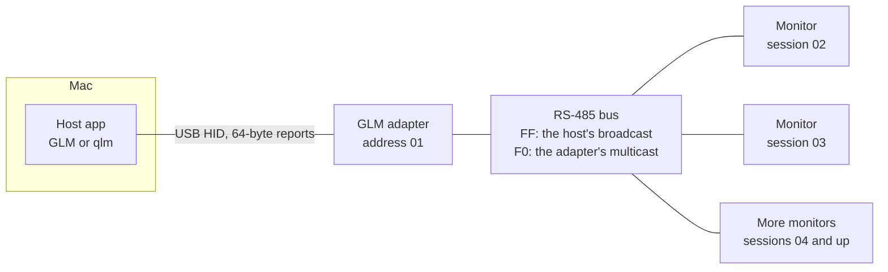

While a host is connected, it runs the bus. It finds the monitors, leases each one a session, polls them, and sends every volume and setting. The adapter passes each request through and hands back exactly one reply. To the host, it speaks for itself only when addressed at `01`, and to say `01 7E` when no monitor answered ([Replies](#replies)). About 2.6 s after the host goes quiet, the adapter takes over on its own, at the knob's position ([The hand-back](#the-hand-back)).

Every capture comes from one system: two 8351B (the Left and the Right), two 8330A, a 7370A, and a 7350A. Its setup has three groups, and each adds monitors to the one before:[^system]

| Group | Monitors |
| --- | --- |
| Main 2x1 | The two 8351B and the 7370A |
| Main 2x2 | Main 2x1, plus the 7350A |
| Main 4x2 | Main 2x2, plus the two 8330A |

[^system]: [telemetry.md](telemetry.md#sources), for the monitors. [measurement.md](measurement.md#the-run-for-main-2x1), and its table in [The other groups](measurement.md#the-other-groups), for the groups.

## Reading this doc

Every fact here names its source, in a footnote or a Source column. A source takes one of these forms:

| Source | What it points to |
| --- | --- |
| `startup-idle`, 8.432 s | A capture in `captures/`, and a time in seconds into its `reports.txt`. Each capture's `notes.md` says what happened when. |
| `testCheckValue` | A test in `Tests/`, by its name. |
| #27 | A pull request in cmicali/qlm. One marked "open" is not on main yet, and neither is what it describes. |
| hlm §7 | A section of hlm's spec: `docs/Genelec GLM Protocol.13.md` in robcazzaro/hlm, revision 13, at commit `c08ced9`. |
| genlc | genlc's code, for a fact the plan took from it. |

hlm, genlc, and espgensam are GPL-3.0. This doc states their facts in our own words, and copies no text or code from them.

A few conventions:

- Bytes are hex. We write a frame as its address and its payload, without the CRC and the flag. So `FF 1F 00 31 07` is the volume broadcast at −56.5 dB.
- "In the captures" means all 21 scenarios in `captures/`. A count comes from decoding every report in them, with each frame's CRC checked.
- **Guess:** marks a guess. [Open questions](#open-questions) lists what we don't know yet.

## USB and HID

To the Mac, the adapter is a plain vendor HID device. Every exchange is one 64-byte output report out, and one or more 64-byte input reports back. Each report holds one bus frame, with a one-byte header in front and zeros behind. In qlm, GLMProtocol packs and reads the reports (`QLMReport.h`), and GLMAdapter's report link moves them (`QLMReportLink.h`).

### The device

| What | Value | Source |
| --- | --- | --- |
| IDs | Vendor `1781`, product `0E39` | The device descriptor in every capture; `testTheAdapterDescriptorsMatchTheReportLayer` |
| Product string | `Gnet Adapter` | The string descriptor in `unplug` and `unplug-proxy-hang`; [captures/README.md](../captures/README.md) |
| Speed | Full speed, USB 1.1: `bcdUSB` 1.10 | [captures/README.md](../captures/README.md); the device descriptor |
| Endpoints | One HID interface, with interrupt endpoints IN `81` and OUT `03`. Each takes 64 bytes and polls every 1 ms. | The configuration descriptor at the top of `startup-idle`'s `reports.txt` |
| Report descriptor | The vendor usage page `FFA0`, and no report IDs. A 64-byte input report, a 64-byte output report, and a 1-byte feature report. | `unplug` and `unplug-proxy-hang`; `testTheAdapterDescriptorsMatchTheReportLayer` |

No capture shows the feature report in use. The only class request in them is the host's Set Idle.[^set-idle]

On the Mac, the system's HID driver owns the adapter's interface. GLM opens the HID device through the HID library, without seizing it. qlm opens it only seized.[^seize]

### Reports

The two directions use different headers. The host's report says how long its frame is. The adapter's doesn't, so you find the end of a reply by its `7E` flag.

```text
Host to adapter: one output report, 64 bytes

 byte 0     1 ... n                         n+1 ... 63
┌──────────┬───────────────────────────────┬────────────┐
│ 80 + n   │ the frame: n bytes, as sent   │ 00 ... 00  │
│          │ address ... CRC, 7E           │            │
└──────────┴───────────────────────────────┴────────────┘

Adapter to host: one input report, 64 bytes

 byte 0     1 ...                                 ... 63
┌──────────┬───────────────────────────────┬────────────┐
│ 3F       │ the frame, up to its 7E       │ 00 ... 00  │
└──────────┴───────────────────────────────┴────────────┘
```

Every output report in the captures has that form.[^out-report] The n counts the frame as it goes out, escapes, CRC, and flag included, so the volume broadcast in [A worked example](#a-worked-example) starts `88`. genlc writes a leading `00` as well, but that's hidapi's report-ID byte, not data.[^genlc-00]

Every input report starts with `3F`, whatever the frame's length. The frame follows, and zeros pad the report after the flag.[^in-report]

A reply that doesn't fit one report runs on into the next. In the captures, only replies to `39` do: 207 of them, and none spans three reports. The adapter's own system info is a 74-byte frame across two reports. A monitor's runs about 66 bytes.[^two-reports] qlm accepts a reply across three reports, as genlc does.[^three-reports]

```text
startup-idle, 7.300 s: the adapter's system info, 74 bytes in two reports

┌────┬──────────────────────────────────────────────────┐
│ 3F │ 01 09 63 2D 30 3B 6D 6F ... 32 30 32 35 2E 30 35 │  the first 63 bytes
└────┴──────────────────────────────────────────────────┘
┌────┬───────────────────────────────────┬──────────────┐
│ 3F │ 2E 31 39 2E 73 20 20 00 4D 20 7E  │ 00 ... 00    │  the last 11, and padding
└────┴───────────────────────────────────┴──────────────┘
```

A report never carries more than one frame. None in the captures does, in either direction.[^one-frame] The longest frame qlm sends, a PEQ band, fits one report even with every byte escaped.[^longest]

The host keeps one request in flight. Every reply in `startup-idle` and `qlm-first-discover` follows its own request, and qlm does the same.[^in-flight] That matters more than it looks: a reply doesn't say what it answers, so the request in flight is how the host knows. [Replies](#replies) has the rest.

One gap: the Pi proxy doesn't forward USB suspend. So no capture shows what the adapter does when the host sleeps.[^suspend]

[^set-idle]: The control requests at the top of each `reports.txt`.
[^seize]: #12, #21.
[^out-report]: `testEveryOutputReportRepacksByteForByte`; `testPacksTheAdapterPollAsCaptured`. The `88`: `startup-idle`, 7.986 s.
[^genlc-00]: genlc's `transport.py`.
[^in-report]: `testEveryScenarioReads`; `testReadRejectsABadInputReport`.
[^two-reports]: The count decodes every report in the captures. The adapter's system info: `startup-idle`, 7.300 and 7.301 s; `testReadsTheAdapterSystemInfoAcrossTwoReports`. A monitor's: `QLMFrame.h`.
[^three-reports]: `QLMReport.h`; `testReadStopsAfterThreeReportsWithNoFlag`.
[^one-frame]: `testEveryOutputReportRepacksByteForByte`, `testEveryReplyReencodesByteForByte`.
[^longest]: `testRefusesAFrameLongerThanOneReport`.
[^in-flight]: #33. qlm's: `QLMReportLink.h`.
[^suspend]: [captures/README.md](../captures/README.md); `sleep-wake-darkwake`'s notes.

## Framing

Inside the reports, the host and the adapter speak the bus's own framing. A frame is an address byte, a payload whose first byte is the opcode, a CRC, and the flag `7E`.[^frame] GLMProtocol builds and parses them.

```text
┌─────────┬────────┬──────────────────┬──────────┬──────┐
│ address │ opcode │ data             │ CRC      │ flag │
│ 1 byte  │ 1 byte │ 0 or more        │ 2 bytes  │ 7E   │
└─────────┴────────┴──────────────────┴──────────┴──────┘
          └─────── the payload ───────┘
└─────── the CRC covers these ────────┘
          └────────────── escaped ───────────────┘
```

The CRC is CRC-16/GSM: polynomial `1021`, initial value 0, no reflection, and a final XOR of `FFFF`.[^crc] It covers the address and the payload before escaping, and goes out big-endian.[^crc-scope]

Two bytes are special, `7E` and `7D`. In the payload and the CRC, `7E` goes out as `7D 5E`, and `7D` as `7D 5D`. You compute the CRC first, then escape.[^escape] The adapter escapes its own replies too. A knob reading of `FF FF FD 7D` comes as `FF FF FD 7D 5D`.[^adapter-escape]

Every frame in the captures passes its CRC: 76,080 sent and 70,214 received.[^crc-all]

Multi-byte integers are big-endian. The exception is the PEQ coefficients, which are little-endian floats.[^endian]

On the bus itself, frames travel on RS-485 as 9-bit characters, at about 288,000 baud. The ninth bit marks the address byte.[^rs485] No USB report carries a ninth bit, so the adapter adds it.[^ninth]

One thing is unverified: whether the address byte is ever escaped. qlm sends it bare. No capture has an address above `19`, so none shows a `7D` or `7E` address. qlm's encoder refuses both, and its leases skip them, so the question can't come up.[^addr-escape]

### A worked example

Here's the volume broadcast at −56.5 dB, GLM's startup level, as it went out in `startup-idle` at 7.986 s:

```text
frame   FF  1F  00 31 07  2C 5A  7E
        │   │   │         │      └─ the flag
        │   │   │         └─ CRC-16/GSM of FF 1F 00 31 07, big-endian
        │   │   └─ the level: a 24-bit gain, -56.5 dB
        │   └─ opcode 1F: the volume
        └─ address FF: the broadcast

report  88 FF 1F 00 31 07 2C 5A 7E 00 00 ... 00
        └─ 80 + 8: the frame is 8 bytes
```

Nothing in it needs escaping. The no-answer frame does. Its payload is the single byte `7E`, so it goes out escaped:[^no-answer]

```text
before escaping   01  7E     53 97
on USB            01  7D 5E  53 97  7E
                      └─ 7E in the payload goes out as 7D 5E
```

[^frame]: hlm §1; `testEncodesTheKeepAliveFromSection7`.
[^crc]: hlm §2; `QLMCRC.h`; `testCheckValue`.
[^crc-scope]: hlm §2; `testBusFrames`.
[^escape]: hlm §1, §2; `testEscapesThePayloadAndRoundTrips`, `testEscapesTheCRC`.
[^adapter-escape]: `sleep-wake-no-sleep`; [adapter-status.md](adapter-status.md#the-replys-layout).
[^crc-all]: Each frame decoded as `testEveryScenarioReads` reads it.
[^endian]: hlm §4; `testWakeStepsAreBigEndian`.
[^rs485]: hlm §1.
[^ninth]: Every output report in the captures.
[^addr-escape]: `testLeasesNoAddressThatNeedsEscapingOrIsTheMulticast`; #9.
[^no-answer]: `startup-idle`, 20.146 s; `testReadsTheNoAnswerFrame`.

## Addresses and leases

Every frame starts with an address. A few are fixed: the broadcast, the adapter's multicast, and the adapter itself. The rest are session IDs, which the host leases to monitors when it finds them. Leases are the part of the protocol most likely to bite you. A monitor that holds one hides from discovery, and monitors drop them on their own.

### The addresses

| Address | What it is | Source |
| --- | --- | --- |
| `FF` | A host's broadcast. GLM sends the probe, the keep-alive, the volume, `2D 00`, `3D 00 00`, and the power steps to it. | hlm §3; the captures |
| `F0` | The adapter's multicast. A host sends every lease to it. Standalone, the adapter sends its own volume and power steps on it. | hlm §3, §9; every lease in the captures |
| `01` | The adapter. Every reply comes from `01`, and a host reaches the adapter itself at `01`. | hlm §3, §8; `startup-idle`, 7.293 s; `testEveryReplyReencodesByteForByte` |
| `02` to `FE` | Session IDs, leased to monitors. qlm leases none of `7D`, `7E`, and `F0`. | hlm §3; `QLMAddressIsLeasable` |

### Discovery and the lease

The host finds monitors with the probe, `FF FE`. One monitor that holds no lease answers, with `09` and its 3-byte hardware ID. The host leases it a session with `F0 02`, the hardware ID, and the session, and the monitor acks with `09` and the session. Then the host probes again, until no monitor without a lease is left. At that point the adapter answers the probe itself, with `01 7E`.[^probe]

The diagram draws each request straight from the host to the monitors. It goes through the adapter, which only passes it on. The adapter shows up when it answers for itself. The other diagrams here work the same way.

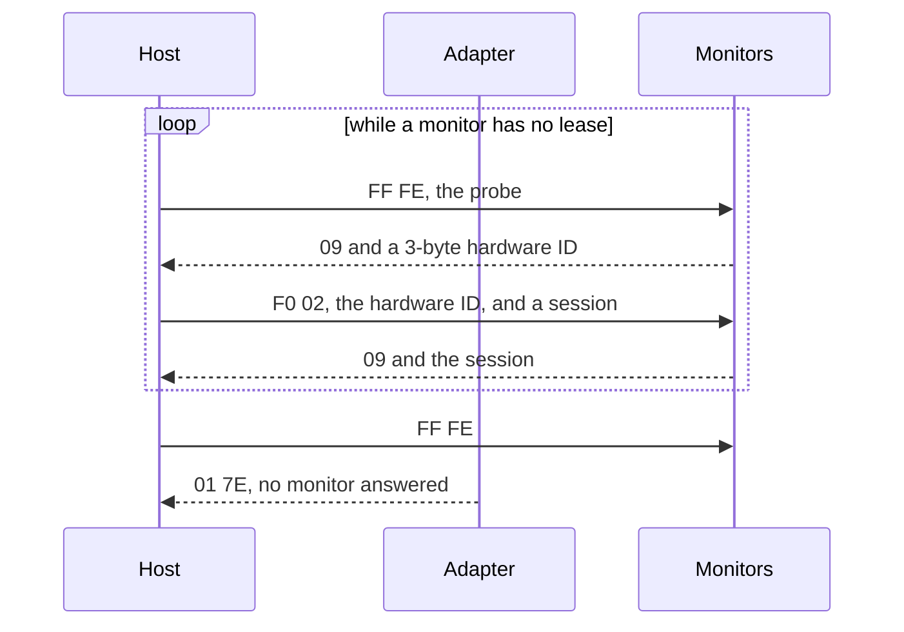

A monitor that holds a lease doesn't answer the probe. Once every monitor holds one, every probe gets `01 7E`: all 1,028 of them in `sleep-wake-darkwake`, for one. While qlm's `poll` held all six leases, every probe got `01 7E` too.[^leased-silent]

> **TRAP:** so a host finds only monitors without a lease. A monitor still holding an earlier host's lease stays hidden. A host that leases from `02` again may give that session to a second monitor, and then two monitors take one monitor's frames.[^trap-lease]

#32 handles it. Before its first probe, qlm asks each monitor it knew for its serial, at its old session. The same serial means the monitor still holds that lease, and qlm takes it back.

The same TRAP waits when the bus comes back to a host. While qlm is refused, GLM may run, lease from `02` in its own probe order, and quit. A host that quits leaves its leases, so qlm's old sessions may now be other monitors'. So a host must not trust its own old sessions. When the bus comes back, qlm drops every monitor it tracked, and checks each old session's serial again. It takes a monitor back only where that monitor's own serial answers. A session that answers with another serial gets no lease and no frame from qlm.[^gap]

The hardware ID is how qlm knows a monitor. It maps one to one to the serial in every capture, so qlm matches monitors by hardware ID.[^hwid] It also ties a monitor to the setup file: a setup node's `Serial` is its monitor's hardware ID, read big-endian, in decimal.[^setup-serial] The serial from `19 01` is something else. It's a model prefix and eight digits, and it never ends in the setup's `Serial`.[^serial-digits] Serials are 14 or 15 characters.[^serial-length]

### How sessions are counted

GLM counts up from `02` at each launch, one per lease, in the order the monitors answer the probe. The count runs on within a launch, through a replug or a wake. qlm does the same. It counts up from `02` at each start, and on within a run, skipping `7D`, `7E`, and `F0`.[^qlm-count] Its first discovery found the six in GLM's order, and leased them GLM's sessions.

| Host, and when | Sessions leased | Source |
| --- | --- | --- |
| GLM, at each of three launches | `02` to `07`, in the same order | `startup-idle`, 8.432 s; `startup-idle-mic`, 8.443 s; `knob-sweep`, 7.627 s |
| GLM, after a replug | `08` to `0D` | `unplug-proxy-hang`, 107.137 s |
| GLM, after a replug | `14` to `19` | `unplug`, 69.241 s |
| GLM, after a wake | `12` to `17` | `standby-wake`, 47.378 s |
| qlm, at its first discovery | The six, at GLM's sessions | `qlm-first-discover`, 56.427 to 56.536 s |
| qlm, at its wake within a run | Three monitors, at `06` to `08` | `qlm-control-first`, 828.326 to 828.371 s |
| qlm, at each of two wakes within a run | All six, at `09` to `0E` | `qlm-control-all`, 575.835 to 575.934 s and 8482.674 to 8482.776 s |

### When a monitor loses its lease

A lease isn't permanent. A monitor loses it when it wakes, sometimes while it sits in standby, and when the host goes quiet. The host also gives up on a monitor that stops answering.

| When | What happens | Source |
| --- | --- | --- |
| It wakes from standby | It loses its lease, and answers the next probe. At GLM's wake, all six did, and GLM leased them `12` to `17`, 0.81 s after its first wake pair. At qlm's wake, all three in the run did: polls to their old sessions got `01 7E`. At both of qlm's wakes on all six, all six did. | `standby-wake`, 46.565 and 47.378 s; `qlm-control-first`, 828.29 to 828.37 s; `qlm-control-all`, 575.78 and 8482.61 s |
| It joins a group from standby | It loses its lease. That's the 7350A in 2x1 to 2x2, both 8330A and the 7350A in 2x1 to 4x2, and both 8330A in 2x2 to 4x2. | The leases in `group-switch-main-2x1-main-2x2`, 10.418 s; `group-switch-main-2x1-main-4x2`, 36.254 to 36.457 s; and `group-switch-main-2x2-main-4x2`, 11.562 and 11.575 s |
| It stays on through a switch | It keeps its session. The switches from 4x2 to 2x1, 4x2 to 2x2, and 2x2 to 2x1 lease nothing. | Each `group-switch-*` capture |
| It sits in standby | It may drop its lease over and over. In `standby-wake`, the Right 8351B answered the probe every 3 s in standby, and GLM leased it `0E`, `0F`, `10`, and `11`. In `qlm-standby-discover`, no monitor did in GLM's 10 s of standby. | `standby-wake`, 37.365 to 45.959 s; `qlm-standby-discover` |
| The host goes quiet | The monitors drop its leases. See below. | |

Frames sent to a lost session get `01 7E`. GLM's block to a monitor that has just woken gets it, from the old session.[^lost-session]

The host drops a monitor that stops answering. After a miss, GLM polls again at once, about 9 ms apart, and most retries get their answer on the second poll. After the fourth miss in a row, it stops polling that session, and the probe finds the monitor again.[^four-misses] qlm drops a monitor after four missed cycles and a burst of four more polls.[^qlm-drop]

#### When the host goes quiet

Monitors drop a host's leases once the host goes quiet. USB can't show why.

| Monitors | After GLM | After qlm | Source |
| --- | --- | --- | --- |
| On | within 42 s | within 23 s | `qlm-first-discover` |
| In standby | within 210 s | within 88 s and 68 s | `qlm-standby-discover` |
| On, across an unplug of the adapter | within 9 s | | `unplug`, 60.4 to 69.2 s |

**Guess:** the adapter's take-over, about 2.6 s after the host goes quiet, ends them. Across the unplug, the adapter lost power, and its restart may have.

So wait between hosts, to avoid the TRAP above: 1 minute with every monitor on, and 4 minutes with any in standby ([measurement.md](measurement.md#wait-between-hosts)).

[^probe]: hlm §7, §9; `startup-idle`, 8.419 to 8.492 s. The lease: hlm §7, §8; `startup-idle`, 8.432 s; `testSessionAckAndHardwareID`.
[^leased-silent]: `sleep-wake-darkwake`; `qlm-standby-discover`'s notes.
[^trap-lease]: #17; [measurement.md](measurement.md#wait-between-hosts).
[^gap]: GLM's leases held for up to 42 s after it quit: `qlm-first-discover`. GLM counts from `02` at each launch: [How sessions are counted](#how-sessions-are-counted). qlm's checks: `testABusThatComesBackChecksEveryLeaseBeforeUsingIt`, `testABusThatComesBackTakesBackTheLeasesStillHeld`.
[^hwid]: #9; #8.
[^setup-serial]: `startup-idle`, the leases at 8.432 to 8.481 s; #8.
[^serial-digits]: #8.
[^serial-length]: #9; `QLMReplies.h`.
[^qlm-count]: #9; `QLMAddressIsLeasable`.
[^lost-session]: `group-switch-main-2x1-main-4x2`, 35.84 to 36.38 s; `standby-wake`, from 46.631 s.
[^four-misses]: `standby-wake`, 35.077 to 35.105 s, then 37.365 s; hlm §3. The second poll: `standby-wake`, 45.973 s.
[^qlm-drop]: `QLMSystem.h`.

## Opcodes

The opcode is the payload's first byte. This table has every opcode in the captures, and the ones qlm never sends. The qlm column says what qlm does with each: it sends it, or refuses it. "Sends" means GLMProtocol's allowlist accepts it and System sends it. The allowlist goes by opcode, with finer checks on `02`, `10`, `2D`, `3A`, `3C`, `3E`, and `42`.[^allowlist] A golden test pins the refused set: `05`, `43`, `4B`, and `22` and `51` to the adapter.[^refused-set] [refused-frames.md](refused-frames.md) has the story of each refused frame.

Every frame qlm sent in its three runs on the adapter is one GLM sends.[^qlm-runs]

| Opcode | What it is | To | Payload after it | Reply | Who sends it, and when | qlm | Source |
| --- | --- | --- | --- | --- | --- | --- | --- |
| `FE` | The probe | `FF` | None | A hardware ID, or `01 7E` | GLM, each cycle, and back to back at discovery | Sends | hlm §7; `startup-idle`, 8.419 s |
| `02` | The lease | `F0` | The 3-byte hardware ID, then the session | `09` and the session | GLM, after each probe answer | Sends, only a leasable session | hlm §7; `testLeasesNoAddressThatNeedsEscapingOrIsTheMulticast` |
| `04` | The keep-alive | `FF` | None | None | GLM, only in a DSP pass | Sends, in an apply | `startup-idle`, 8.534 s; #12 |
| `05 04` | The generator stop | A session | `00 00 00 FF FF EA 00 01 90 00 02 DA` | `09` | GLM, in every block at launch, and in a switch's routing pass | Refuses. Never send. | hlm §7; [refused-frames.md](refused-frames.md#05-04--the-generator-stop) |
| `08` | The poll | A session | None | Telemetry, a bare `09`, a busy marker, or `01 7E` | GLM, each cycle | Sends | hlm §7; [telemetry.md](telemetry.md) |
| `08` | The status poll | `01` | None | The adapter's status | GLM, in pairs, about every 107 ms | Sends | [adapter-status.md](adapter-status.md) |
| `10 01 00` | The level | A session | A word | `09` | GLM, in each block | Sends | hlm §6; #15 |
| `10 01 05` | Part of hlm's store sequence | | A word | | Never in the captures. hlm's store sequence sends it. | Refuses | hlm §9; `testTheAllowlistRefusesWhatQLMNeverSends` |
| `10 01 09` | Unknown | A session | `00 00 00` | `09` | GLM, in each block | Sends | hlm §6; the captures |
| `10 02` | The delay | A session | A count of samples | `09` | GLM, in each block | Sends | hlm §6; #8 |
| `10 0E` | A PEQ band | A session | The slot, five floats, and `00` | `09` | GLM, twenty or more in each block | Sends | hlm §5; #10 |
| `15` | The flash commit | | | | Never in the captures | Refuses. Never send. | hlm §7; AGENTS.md |
| `17 01` | Unknown | A session | None | `09` | GLM, first in each block | Sends | hlm §7; `startup-idle`, 8.538 s |
| `19 01` | The serial | A session, or `01` | None | The serial, in ASCII | GLM, at discovery, after each block, and to the adapter at open | Sends | hlm §7, §8; `startup-idle`, 7.304 s |
| `1F` | The volume | `FF` | A 24-bit gain | None | GLM, each cycle, and at once on a change. The adapter, standalone, on `F0`. | Sends, under the ceiling | hlm §7, §9; `volume-sweep` |
| `22` | The adapter's identity | `01` | None | The identity, in ASCII | GLM, once per connection | Refuses | [refused-frames.md](refused-frames.md#01-22) |
| `2B` | Mute and the LED | A session | A value | `09` | GLM, in rounds of mute state | Sends | hlm §7; `mute-dim` |
| `2B` | Mute, to the adapter | `01` | `00` or `01` | `09` | GLM: mute all, unmute all, startup, the knob, a switch's tail, and a wake | Sends | [refused-frames.md](refused-frames.md#01-2b-00-and-01-2b-01) |
| `2D` | Unknown | `FF` | `00` | None | GLM, right before `FF 3D 00 00`, each time | Sends, only `2D 00`, only as a broadcast | [refused-frames.md](refused-frames.md#broadcast-2d-00-and-3d-00-00); #20 |
| `39` | System info | A session, or `01` | None | System info, in ASCII | GLM, at discovery, after each block, and to the adapter at open | Sends | hlm §7, §8; `startup-idle`, 7.299 s |
| `3A 01`, `3A 02`, `3A 06` | Standalone settings | | | | Never in the captures | Refuses. Never send. | hlm §7; AGENTS.md |
| `3A 03` | Power | `FF` | A step | None | GLM: standby, wake, and a switch. The adapter, standalone, on `F0`. | Sends | hlm §7, §9; `standby-wake` |
| `3A 03` | Power | A session | A step | `09` | GLM, only in a switch's routing pass | Sends | The six `group-switch-*` captures |
| `3B` | The crossover | A session | A 16-bit value | `09` | GLM, in each block, and a subwoofer's routing pass | Sends | hlm §7; the captures |
| `3C`, `3E`, `42` | Unknown | A session | `00 00` | `09` | GLM, only to the subwoofers, in their blocks | Sends, only these, only to a session | [refused-frames.md](refused-frames.md#3c-3e-and-42-to-the-subwoofers); #24 |
| `3D` | Unknown | A session | `00 00` | `09` | GLM, in each block | Sends | hlm §7; #20 |
| `3D` | Unknown | `FF` | `00 00` | None | GLM, right after `FF 2D 00` | Sends | #20 |
| `40` | The routing | A session | The routing | `09` | GLM, in each block and the routing pass | Sends | hlm §7; #8 |
| `43`, `4B` | Unknown | A session | `00 02`, and `00 00 00 01` | `09` | GLM, only to the 8351B, in its blocks | Refuses, until the 8351B's rate is verified | [refused-frames.md](refused-frames.md#43-00-02-and-4b-00-00-00-01-to-the-8351b) |
| `51` | Unknown | `01` | `82` | ASCII `219000` | GLM, once per connection | Refuses | [refused-frames.md](refused-frames.md#01-51-82) |

[^allowlist]: `QLMFrameAllows`; `testTheAllowlistAcceptsWhatQLMSends`.
[^refused-set]: `testEveryOutputReportRepacksByteForByte`.
[^qlm-runs]: `qlm-first-discover`, `qlm-standby-discover`, and `qlm-control-first`, and their notes; `QLMControlRunTests`.

### Payloads

Most payloads are short and fixed. These are the ones with structure worth knowing.

#### `1F`, the volume

The volume is a 24-bit linear gain, with `7F FF FF` at 0 dB.[^volume] GLM's volume runs from 0 to −99.5 dB in 0.5 dB steps, which makes 200 levels. The captures hold each one, and qlm takes its words from a table of them.[^volume-table] A table, because no formula gives all 200. `floor(10^(dB/20) × 7FFFFF)` misses four by one count, and a scale of 2²³ misses ten.[^volume-formula]

| Word | What it is | Source |
| --- | --- | --- |
| `7F FF FF` | 0 dB | hlm §4 |
| `0C CC CC` | −20 dB | `quit-glm`, 0.3 s |
| `00 31 07` | −56.5 dB, GLM's startup level | [adapter-status.md](adapter-status.md#what-glm-does-with-the-knob) |
| `00 04 E7` | 20 dB below `00 31 07`, as dim sends it | `mute-dim`, 51.24 s |
| `00 00 08` | The bottom stop, −100 dB | `volume-sweep`, 28.36 s; `testTheBottomStopIsGLMs` |
| `00 00 02` | The duck under an apply. It is not a level of the volume. | hlm §4; `group-switch-main-4x2-main-2x1`, 12.359 s; `testEveryVolumeFrameGLMSentIsAStep` |

GLMProtocol caps every volume frame at the user's ceiling.[^ceiling]

#### `2B`, mute and the LED

Bit 0 mutes, and bits 1 and 2 pick the LED's color.[^mute-bits] GLM sends monitors four values: `03` muted, `04` unmuted, and `05` then `07` to a monitor outside the active group.[^mute-values] To the adapter, it sends `2B 01` at mute all, and `2B 00` otherwise.[^mute-adapter]

#### `3A 03`, power

`02` prepares for standby, `00` powers off, and `7F` then `01` wake.[^power] [Sleep and wake](#sleep-and-wake) has the order.

#### `10 02`, the delay

The delay is a 4-byte count of samples at 48 kHz, on every model.[^delay] A monitor's is its `Time-of-flight_Compensation` in milliseconds, times 48. A subwoofer's is its phase at the crossover, turned into a delay and rounded.[^delay-sub] GLM rounds and does not floor: 105° at 85 Hz is 164.7 samples, and goes out as 165.

| Node | Setting | Samples | Source |
| --- | --- | --- | --- |
| A monitor | 6 ms | 288, `00 00 01 20` | `group-switch-main-2x1-main-4x2`; #8 |
| A monitor | 1.23 ms | 59, `00 00 00 3B` | `group-switch-main-2x1-main-4x2`; #8 |
| A subwoofer | 180° at 60 Hz | 400 | `startup-idle` |
| A subwoofer | 150° at 85 Hz | 235 | The subwoofers' `10 02` frames in the group switches, against `Phase(degrees)` in `Main.sam`; `QLMDSPBlockGoldenTests` |
| A subwoofer | 105° at 85 Hz | 165, rounded from 164.7 | The same |
| A subwoofer | 90° at 85 Hz | 141 | The same |
| A subwoofer | 165° at 85 Hz | 259 | The same |

#### `10 01 00`, the level

A linear gain at 2²³ − 1, floored. It carries `Level_Sensitivity` plus `Group_Sensitivity` from the setup.[^level]

#### `10 01 09 00 00 00`

Always these zeros, in all 79 blocks in the captures. We don't know what it sets.[^level-09]

#### `10 0E`, a PEQ band

The slot, then `b0`, `b1`, `b2`, `−a1`, and `−a2`, normalized by `a0`, as little-endian floats, then `00`.[^peq] A flat band goes out as `1, 0, 0, 0, 0`.[^peq-flat]

```text
The payload of 10 0E, with each field's size in bytes

┌───────┬──────┬──────┬──────┬──────┬──────┬──────┬────┐
│ 10 0E │ slot │ b0   │ b1   │ b2   │ -a1  │ -a2  │ 00 │
│ 2     │ 1    │ 4    │ 4    │ 4    │ 4    │ 4    │ 1  │
└───────┴──────┴──────┴──────┴──────┴──────┴──────┴────┘
```

GLM designs in double precision, rounds the six raw coefficients to float, and normalizes in float.[^peq-design]

The design rate is 48 kHz for the 8330A, and 12 kHz for the subwoofers.[^peq-rate] The 8351B's bands match a 96 kHz design to the bit, and no 48 kHz design. No measurement confirms that rate yet.[^peq-rate-8351b]

GLM sends all twenty slots in every block, not only the changed ones. A subwoofer's block sends 23 PEQ frames, with slot 0 four times.[^peq-twenty]

#### `3B`, the crossover

A big-endian 16-bit value. The captures hold `00 3C`, 60 Hz, in Main 2x1, and `00 55`, 85 Hz, in Main 2x2 and Main 4x2.[^crossover] hlm reads a small value such as `00 01` as full band.[^crossover-full]

#### `40`, the routing

The input index, the source, a pair selector, and the AES3 channel.[^routing] Inputs 1 to 3 route as AES3: `40 00 02 00` and the channel, which is `01` for A, `02` for B, and `03` for both.[^routing-aes] Each subwoofer also gets `40 01 02 00 00`, and we don't know what it routes.[^routing-sub] No group in the setup uses input 4, the analog input, so no capture shows its frame. qlm marks it unverified.[^routing-analog]

[^volume]: hlm §4; `quit-glm`, 0.3 s.
[^volume-table]: `testEveryStepIsTheLevelGLMSent`; #11.
[^volume-formula]: `QLMCommands.c`; #11; [adapter-status.md](adapter-status.md#the-mapping).
[^ceiling]: `testEveryVolumeBuilderHonorsTheCeiling`, `testNoVolumeFramePassesTheCeiling`.
[^mute-bits]: hlm §7.
[^mute-values]: `mute-dim`; `knob-sweep`, 19.135 s; `QLMCommands.h`.
[^mute-adapter]: `mute-dim`, 46.189 and 48.596 s.
[^power]: hlm §7.
[^delay]: hlm §6.
[^delay-sub]: hlm §6; #8.
[^level]: hlm §6; #15; `testGLMFloorsTheLevelWord`.
[^level-09]: hlm §6.
[^peq]: hlm §5.
[^peq-flat]: hlm §5; `startup-idle`, 8.553 s.
[^peq-design]: #10.
[^peq-rate]: hlm §4.
[^peq-rate-8351b]: #10; `QLMDSPBlockGoldenTests`.
[^peq-twenty]: #9; `QLMDSPBlockGoldenTests`.
[^crossover]: [refused-frames.md](refused-frames.md#43-00-02-and-4b-00-00-00-01-to-the-8351b).
[^crossover-full]: hlm §7.
[^routing]: hlm §7.
[^routing-aes]: `group-switch-main-2x1-main-4x2`; #8.
[^routing-sub]: [refused-frames.md](refused-frames.md#3c-3e-and-42-to-the-subwoofers).
[^routing-analog]: #8.

## Replies

Replies are the awkward part. Every reply comes from `01`, and none of them says which request it answers. The host has to remember what it asked. That's why GLM and qlm both keep one request in flight, and why qlm sends a sync when it loses track.

Every reply comes from `01`, and a monitor's starts with `09`.[^reply-from-01] The adapter answers every probe and unicast with exactly one frame: the monitor's reply, or its own `01 7E` when no monitor answered. A broadcast gets nothing back.[^one-reply]

A reply names no request. The adapter's status reply carries nothing of the `01 08` it answers, and an ack is a bare `01 09`.[^no-echo] Only the request just sent says what a reply answers.

### The shapes

So qlm reads each reply against the request in flight. This is what each shape looks like after the `01`, and what it answers.

| Reply | After `01` | Answers | How qlm tells it apart | Source |
| --- | --- | --- | --- | --- |
| Ack | `09` | Every block frame, `2B`, `3A 03` to a session, `05 04`, and `01 2B` | The request in flight | hlm §8; the captures |
| Lease ack | `09` and the session | `02` | The request in flight. See the TRAP below. | hlm §8; `testSessionAckAndHardwareID` |
| Hardware ID | `09` and three bytes | `FE` | The request in flight | hlm §8; `startup-idle`, 8.424 s |
| Telemetry | `09`, maybe `06` or `07`, `41`, the temperature, then tag-value fields | `08` | The request in flight | hlm §8.1; [telemetry.md](telemetry.md) |
| No new telemetry | `09` alone, or `09 06` or `09 07` | `08` | The request in flight | hlm §8; [telemetry.md](telemetry.md#the-frame) |
| Serial | `09` and 14 or 15 ASCII characters, with no NUL | `19 01` | The request in flight | hlm §8; `testTextReplies` |
| System info | `09` and NUL-terminated ASCII | `39` | The request in flight. A sync also checks for its `model-` field. | hlm §8; `testSystemInfoParse` |
| The adapter's status | `09`, then `33` or `32 34 DE … DD …`, then `31` or `30 36 DF …` | `01 08` | The request in flight. A sync also checks its exact shape. | [adapter-status.md](adapter-status.md) |
| The adapter's identity | `09`, space-separated ASCII, a space, and a NUL | `01 22` | qlm refuses `01 22`, so never sees it | [refused-frames.md](refused-frames.md#01-22) |
| No answer | A payload of one byte, `7E`, sent escaped: `01 7D 5E 53 97 7E` on USB | Any probe or unicast no monitor answered | Its payload. qlm reads it as no reply. | `startup-idle`, 20.146 s; `testReadsTheNoAnswerFrame`; `testTheNoAnswerFrameIsNoReply` |

> **TRAP:** `09 06` is a busy marker, and also the lease ack for session `06`. Only the request tells them apart.[^trap-busy]

Two shapes never turn up as the answer to anything else. In every capture, a reply has the adapter status's exact shape only when it answers `01 08`, and reads as system info with a `model-` field only when it answers `39`.[^two-shapes] qlm's syncs rest on that.

Here's why qlm needs syncs. A reply that comes after its timeout would answer the next request. So after a timeout, the report link sends a sync whose shape the late reply can't have, and drops replies until the sync's comes. Each open syncs too: first `01 39`, then `01 08`, since GLM's last request before it quits is `01 08`.[^sync]

> **TRAP:** the status walk reads a serial, and most other replies, as a status. Only the exact shape check tells a status apart.[^trap-walk]

### System info

`39` gets back ASCII fields split by semicolons: `c-`, `model-`, `ver-`, `hw-`, and `build-`. hlm also saw a space-separated form.[^sysinfo]

The adapter's reads `model-GLM Adapter`, `ver-1.4.0.6113`, and `hw-0.0.202`, built 2025-05-19.[^sysinfo-adapter]

`c-` differs by model: `0` for the adapter, `1` for the subwoofers, `2` for the 8330A, and `3` for the 8351B.[^c-field] **Guess:** it is the model's class. Telemetry's `84` reads `02` for the 8351B, though, as for the 8330A.[^c-84]

### The adapter's status

[adapter-status.md](adapter-status.md) decodes the reply to `01 08`. The short version: after `09` come tag-value fields, with no length bytes. A tag's top two bits give its value's length. That's an inference, but it fits every `08` reply in the captures, the monitors' telemetry included.[^tag-rule]

| A tag's top two bits | Its value | Tags in the captures |
| --- | --- | --- |
| `00` | None | `30` to `34`, `36`, and the busy markers `06` and `07` |
| `01` | 1 byte | `41` to `49` |
| `10` | 2 bytes | `81` to `8A` |
| `11` | 4 bytes | `DD`, `DE`, and `DF` |

The usual reply, with no mic and the knob in, looks like this:[^status-example]

```text
startup-idle, 7.294 s

01 09  33  30 36  DF FF FF FC 14  F5 ED  7E
       │   │      │               │      └─ the flag
       │   │      │               └─ the CRC
       │   │      └─ DF: the knob's position, -1004 tenths of a dB
       │   └─ 30 36: the knob is in
       └─ 33: no mic
```

`30` or `31` says whether the knob is in, and `32` or `33` the mic. `DF` holds the knob's position, a signed count of tenths of a dB. `DE` and `DD` hold two mic readings.[^status-fields] `DF` reads about −1004 at the knob's bottom stop, and 0 at its top.[^df-range]

No field speaks of the host, mute, standby, or a group. The shape holds from GLM's first poll in every Phase 0 capture.[^status-nothing] The adapter answers each poll within about 1.5 ms,[^status-time] and every one of the 35,983 polls in the captures got a reply.

### Telemetry

[telemetry.md](telemetry.md) decodes it. For qlm, the parts that matter most are the power state, the kind of model, and what's missing, which is mute.

| Tag | While on | In standby | Source |
| --- | --- | --- | --- |
| `47`, the power state | `01` | `02` | hlm §8.1; `qlm-standby-discover`, `standby-wake` |
| `84`, its first byte | `01` for a subwoofer, and `02` for the two-way and three-way models | `03`, after the first frame or two | hlm §8.1; `qlm-control-first`, 829.397 s; `qlm-standby-discover`; `standby-wake`, 35.685 and 36.242 s |

hlm saw `47` read `03` in standby, when its own firmware drove the monitors. No capture here shows it.[^power-03] A standby reply drops the meters and the `81` to `83` readings.[^standby-drops]

A monitor makes a new frame about once a second, and a poll before it gets a bare `09`.[^once-a-second] A frame sometimes comes split across two polls.[^split]

Two replies end with a bare `04` after `8A`'s value. In every other reply, `8A` comes last. Both came from the 8330As, busy, 1.4 s after GLM's apply at launch began. qlm's parser stops at the `04`, and System keeps what came before it.[^bare-04]

No reply reports a monitor's mute. Not the telemetry, the `2B` ack, `19 01`, `39`, or the adapter's status. A muted monitor's output meters read their floor, `80`, but so does silence.[^no-mute]

### `01 7E`

The adapter sends `01 7E` when no monitor answered.[^no-answer-sent] It's slower than any monitor. It comes 8.1 to 11.1 ms after the request, 8.6 ms at the median, across its 3,946 instances in the captures. The slowest is in `group-switch-main-2x1-main-4x2`, at 36.053 s. A monitor's reply comes within 7.1 ms, 1.6 ms at the median. **Guess:** the adapter waits about 8 ms for a monitor.

You'll see it in three places:

- It answers the probe once every monitor holds a lease ([Discovery and the lease](#discovery-and-the-lease)).
- It answers a frame to a session that just lost its lease ([When a monitor loses its lease](#when-a-monitor-loses-its-lease)).
- A monitor in standby misses a request at times, and answers the next try. qlm's polls in standby got `01 7E` three times in 10 s, and GLM's once. GLM's got it eight times in `standby-wake`.[^standby-misses]
- A lease to a monitor in standby can miss too. Twice, as qlm's wake began, one monitor in standby acked no lease, and frames to its new session got `01 7E` for 40 ms. It answered the next probe, and took the next session.[^standby-lease-miss]

[^reply-from-01]: hlm §8; `testEveryReplyReencodesByteForByte`.
[^one-reply]: `testEveryReplyAnswersItsRequest`; `testWhichMessagesExpectAReply`.
[^no-echo]: `startup-idle`, 7.294 s; [adapter-status.md](adapter-status.md#the-replys-layout).
[^trap-busy]: `QLMReplies.h`.
[^two-shapes]: `testOnlyStatusPollsAndSystemInfoQueriesGetTheirShapes`.
[^sync]: #12, #33; `QLMReportLink.h`; `testGLMsLastRequestBeforeItQuitsIsAStatusPoll`.
[^trap-walk]: `QLMReplies.h`; `testOnlyTheStatusShapesAreAStatus`.
[^sysinfo]: `startup-idle`, 7.300 s and 8.493 to 8.533 s. The space-separated form: hlm §8.
[^sysinfo-adapter]: `startup-idle`, 7.300 s; [adapter-status.md](adapter-status.md#how-the-adapter-knows-a-host-is-present).
[^c-field]: The same replies.
[^c-84]: `qlm-control-first`, 829.397 s.
[^tag-rule]: [adapter-status.md](adapter-status.md#the-replys-layout).
[^status-example]: `startup-idle`, 7.294 s; [adapter-status.md](adapter-status.md#the-replys-layout).
[^status-fields]: [adapter-status.md](adapter-status.md#the-replys-layout).
[^df-range]: `knob-sweep`, 33.21 and 20.17 s; [adapter-status.md](adapter-status.md#the-knob-df).
[^status-nothing]: [adapter-status.md](adapter-status.md#the-replys-layout).
[^status-time]: [adapter-status.md](adapter-status.md#the-poll).
[^power-03]: hlm §8.1, Appendix B item 9.
[^standby-drops]: `qlm-standby-discover`.
[^once-a-second]: [telemetry.md](telemetry.md#one-frame-a-second).
[^split]: [telemetry.md](telemetry.md#split-frames).
[^bare-04]: `qlm-control-all`, 381.151 and 381.166 s; `testEveryReplyAnswersItsRequest`; `QLMSystem.m`.
[^no-mute]: #27; `mute-dim`.
[^no-answer-sent]: #9; `testTheNoAnswerFrameIsNoReply`.
[^standby-misses]: `qlm-standby-discover`; `standby-wake`.
[^standby-lease-miss]: `qlm-control-all`, 575.004 to 575.050 s and 8481.292 to 8481.337 s.

## Timing

The protocol has no clock of its own. These times are what GLM does, how the hardware answers, and what qlm copies. Two matter most for qlm. The status poll is the knob's only path to the host, and likely how the adapter knows a host is there. The 2.6 s hand-back decides what the user hears when qlm stops.

| What | Time | Source |
| --- | --- | --- |
| GLM's idle cycle: the probe, the volume, and one `08` to each monitor | About every 0.57 s. The notes measure 0.564 to 0.571 s. | `startup-idle`, from 10 s; 20.137 and 20.705 s, for two; the notes of `qlm-first-discover` and `qlm-standby-discover` |
| qlm's cycle | A probe every 0.569 s in `qlm-first-discover`, and 0.570 s in `qlm-standby-discover` | `qlm-first-discover` and `qlm-standby-discover`, their notes; `QLMSystem.h` |
| GLM's status polls | Pairs of `01 08`, 2.4 ms apart, a pair about every 107 ms. That's about 17 polls a second, and five pairs between two cycles. | [adapter-status.md](adapter-status.md#the-poll); `startup-idle`, 20.137 to 20.705 s |
| qlm's status polls | A pair every 107 ms | `qlm-first-discover`; `QLMSystem.h` |
| GLM's longest silence, while it runs | 0.22 s between two of its reports. 1.70 s between two `01 08` polls, in a group switch. | [adapter-status.md](adapter-status.md#how-the-adapter-knows-a-host-is-present) |
| The adapter's status reply | Within about 1.5 ms | [adapter-status.md](adapter-status.md#the-poll) |
| A monitor's reply | Within 7.1 ms, 1.6 ms at the median. The slowest is a `39`, whose reply spans two reports. | `qlm-control-all`, 8481.361 s |
| `01 7E` | 8.1 to 11.1 ms, 8.6 ms at the median. Its 11.1 ms, after a PEQ band to a monitor that had just lost its lease, is the slowest reply in the captures. | `group-switch-main-2x1-main-4x2`, 36.053 s |
| qlm's request timeout | 0.1 s | `QLMReportLink.h` |
| GLM's retry after a missed poll | At once, about 9 ms apart | `standby-wake`, 35.077 to 35.105 s |
| A knob-driven level | 1.7 to 42 ms after the poll that read the knob, 2.2 ms at the median | [adapter-status.md](adapter-status.md#how-knob-turns-reach-glm) |
| GLM following the knob | About 2.5 s after each move of more than a whole dB. A change 2.53 s on still moved GLM, and from 2.55 s none did. qlm uses 2.54 s. | `sleep-wake-darkwake`, 132.02 and 28.88 s; `QLMKnob` |
| qlm's volume | At most one frame every 50 ms | `QLMSystem.h` |
| The standby steps: `3A 03 02` twice, then `3A 03 00` twice | 21.6 to 22.0 ms apart | `standby-wake`, 34.856 s; `testSleepIsGLMs`; hlm §7 |
| The wake: `3A 03 7F` and `3A 03 01` back to back, three pairs | 0.20 to 0.21 s between pairs | `startup-idle`, 7.332 s; `testWakeIsGLMs` |
| The level after a wake | 0.235 s after the last pair. qlm's came 0.247 and 0.249 s after it. | `standby-wake`, 47.243 s; `testWakeIsGLMs`; `qlm-control-all`, 575.768 and 8482.601 s; `testTheWakeEndsAsGLMs` |
| The first probe answer after a wake | 0.81 s after the first pair in `standby-wake`, 0.50 s in `qlm-control-first`, and 0.68 and 0.67 s in `qlm-control-all` | `standby-wake`, 47.373 s; `qlm-control-first`, 828.290 s; `qlm-control-all`, 575.776 and 8482.608 s |
| The first telemetry that says on | 1.6 s after the first pair in `qlm-control-first`, and 1.5 and 1.7 s in `qlm-control-all`. 2.5 s in `standby-wake`, near the end of GLM's apply at wake. hlm saw 1.55 to 1.66 s on two 8320A. | `qlm-control-first`, 829.397 s; `standby-wake`, 49.05 s; hlm §7 |
| A new telemetry frame | About once a second | [telemetry.md](telemetry.md#one-frame-a-second) |
| GLM's apply at launch | 1.4 s for six monitors | `startup-idle`, 8.534 to 9.901 s |
| A group switch with no monitor waking | 1.1 s | `group-switch-main-4x2-main-2x1`, 12.359 to 13.476 s |
| A monitor in standby dropping its lease | Every 3 s, for the Right 8351B in `standby-wake` | `standby-wake`, 37.365 to 45.959 s |
| Leases, once the host goes quiet | On: within 42 s of GLM, and 23 s of qlm. In standby: within 210 s of GLM, and 88 s and 68 s of qlm. Across an unplug: within 9 s. | `qlm-first-discover`; `qlm-standby-discover`; `unplug`, 60.4 to 69.2 s |
| The adapter's broadcast of `F0 1F 00 00 00`, while a host is connected | About every 610 ms | hlm §9 |
| The hand-back | About 2.6 s after the host goes quiet | `qlm-control-first`, 289.7 s; hlm §9 |

GLM sends no `04` keep-alive while idle. `04` comes only in a DSP pass: the apply at launch, the one after a wake, and a group switch.[^no-keep-alive] hlm reports `04` once a cycle, every 1.2 to 1.8 s, in its bus captures. GLM 5 sends none while idle.[^hlm-keep-alive]

The second poll of a pair rarely brings news. The knob differs between the two in 22 of 14,096 pairs.[^second-poll]

GLM sends a new level at once, out of the cycle.[^level-at-once]

### The hand-back

About 2.6 s after the host goes quiet, the adapter takes over at the knob's position. We saw it in the control run. After `volume -60`, the level rose back to the knob's −40 dB 2 to 3 s after the Mac's sound, which played 0.2 s after qlm's last report.[^hand-back] hlm gives the timeout as about 2.6 s too.[^hand-back-hlm] GLM's longest silences, 0.22 s between reports and 1.70 s between polls, fit inside it.[^hand-back-gaps]

The run on all six heard the same at every exit. The level went back to the knob's 2 to 3 s after the Mac's sound, which played about 0.5 s after qlm's last report. When qlm stopped at the knob's level, no one heard a change.[^hand-back-all]

[^no-keep-alive]: `startup-idle`, from 10 s; #12.
[^hlm-keep-alive]: hlm §7.
[^second-poll]: [adapter-status.md](adapter-status.md#the-poll).
[^level-at-once]: hlm §7.
[^hand-back]: `qlm-control-first`, 289.7 s.
[^hand-back-hlm]: hlm §9.
[^hand-back-gaps]: [adapter-status.md](adapter-status.md#how-the-adapter-knows-a-host-is-present).
[^hand-back-all]: `qlm-control-all`, at 81.4, 442.0, 456.8, 8410.5, 8425.4, 8494.1, and 8663.8 s, and its notes.

## Sequences

This is where the pieces come together. Each thing qlm does is a short run of frames that GLM sends too, and qlm matches GLM byte for byte where it can. The table is the index, and each sequence after it has a short diagram.

Three terms come up a lot:

- A round is one `2B` to every monitor that is on, in the setup's device order. It restates every monitor's mute state.
- The pair is `FF 2D 00`, then `FF 3D 00 00`.
- A block is one monitor's DSP settings, starting with `17 01`. [The block](#the-block) has each model's.

| Feature | On the wire | Section |
| --- | --- | --- |
| Find monitors | The probe and the lease until `01 7E`, then `39`. A monitor that misses four polls is found again. | [Discovery](#discovery) |
| Identify | `19 01`, the serial, and `39`, the system info | [System info](#system-info) |
| Status | `08`, answered with telemetry about once a second. `47` is the power state. | [Telemetry](#telemetry) |
| Volume | `FF 1F` with one of GLM's 200 levels, from a table, each cycle and at once on a change | [Volume and the knob](#volume-and-the-knob) |
| The knob | Its position rides the adapter's reply to `01 08`. The host sends the level. | [Volume and the knob](#volume-and-the-knob) |
| Dim | GLM's sequence: the level 20 dB down twice, a round of `2B`, then `FF 2D 00` and `FF 3D 00 00` | [Dim](#dim) |
| Mute | Two rounds of `2B` to every monitor that is on. Mute all also sends `01 2B 01`. No reply reports mute. | [Mute and mute all](#mute-and-mute-all) |
| Power | Standby: `3A 03 02` twice, then `3A 03 00` twice. Wake: three pairs of `3A 03 7F` and `3A 03 01`, then the level and the pair. | [Sleep and wake](#sleep-and-wake) |
| Group | Two kinds: the apply at launch and wake, and a group switch | [The group apply](#the-group-apply) |
| The host leaving | Nothing is sent. The adapter takes over at the knob's position about 2.6 s later. | [What the adapter and the monitors do on their own](#what-the-adapter-and-the-monitors-do-on-their-own) |

### GLM's startup

GLM opens the same way at launch and after a replug.[^glm-opens] It asks the adapter who it is, wakes the monitors, sets its own level, and only then looks for monitors. The times are from `startup-idle`.

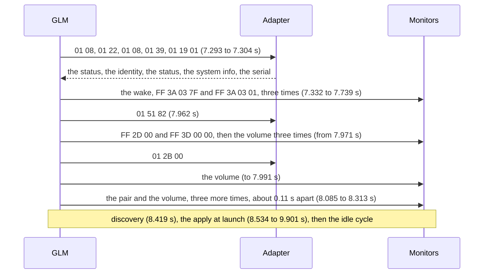

After that come the idle cycle, and the adapter's polls between cycles. GLM opens at its own level, not the knob's: `00 31 07`, −56.5 dB.[^glm-level] That's the startup level in `Main.sam`.[^main-sam]

### qlm's startup

qlm's opening is shorter. It syncs, asks the adapter who it is, and goes straight to discovery.

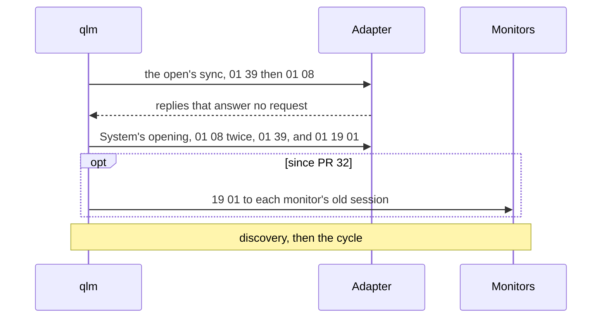

The sync's replies answer no request.[^open-sync] System's opening is from `qlm-first-discover`, at 24.940 to 24.947 s, before #33 added the sync. #32 adds the `19 01` to each monitor's old session, before the first probe.

qlm leaves out `01 22`, `01 51 82`, the wake, the pair, and `01 2B 00` at connect. It sends no volume until one is set. The adapter bridged qlm without them.[^qlm-leaves-out]

### Discovery

[Discovery and the lease](#discovery-and-the-lease) has the probe and the lease. GLM and qlm wrap them differently:

| | GLM | qlm |
| --- | --- | --- |
| After each lease ack | Probes again at once | Sends the volume, once one is set, ahead of everything queued. Then asks the new monitor's `39`, `19 01`, and `08`, and probes again. |
| Once the probe gets `01 7E` | Sends the volume, then `39` to each new monitor | Runs the cycle |
| Source | `startup-idle`, 8.419 to 8.533 s | `qlm-first-discover`, 56.42 s; #27; `qlm-control-all`, 214.774 s |

qlm sends the volume first because a monitor that is switched on plays at its stored level until a host sends one ([What the adapter and the monitors do on their own](#what-the-adapter-and-the-monitors-do-on-their-own)).

It works on the monitors. In `qlm-control-all`, the Rear Right 8330A was switched on during a 90 s hold at −50 dB. It answered the probe and took session `07`. qlm's level went to it 1.1 ms after the ack, outside the cycle and before its `39`. No one heard a burst.[^new-monitor] Each monitor that wakes gets the level the same way ([Sleep and wake](#sleep-and-wake)).

Monitors in standby answer discovery without a wake: the probe, the lease, `39`, `19 01`, and `08`. They stay in standby.[^standby-discovery] A monitor that drops out is found again by the probe, at the next session ([When a monitor loses its lease](#when-a-monitor-loses-its-lease)).

### Volume and the knob

The volume is the simplest frame, and the one sent most. GLM restates it once a cycle, and sends a new level at once.[^volume-cycle] The knob is where it gets interesting. It plugs into the adapter, but while a host is connected, the adapter doesn't apply it. The host reads the knob's position from the reply to `01 08`, and sends the level itself.

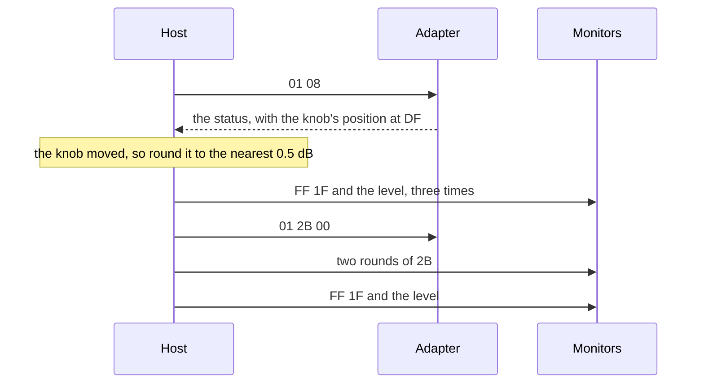

That burst is GLM's: the level three times, `01 2B 00`, two rounds of `2B`, then the level again.[^knob-burst] GLM turns each change into a level by rounding the reading, in tenths of a dB, to the nearest 0.5 dB.[^knob-round] It sends the burst on every change it follows, even when its level stays.[^burst-every-change]

With the knob in, GLM locks its on-screen volume. With the knob out, the reply carries `31`, and GLM unlocks it.[^knob-lock]

GLM doesn't follow every change, though. It keeps the last reading it followed, and moves the level only when a new reading is more than a whole dB from it: 11 tenths or more. How slowly the knob got there doesn't matter. Then, for about 2.5 s, GLM follows every change, even a single tenth. Each further move of more than a whole dB starts the 2.5 s again, so a turn is followed to its end. Outside that time, a change of a whole dB or less moves nothing. When GLM opens, the knob's first reading is where it rests.[^knob-rule]

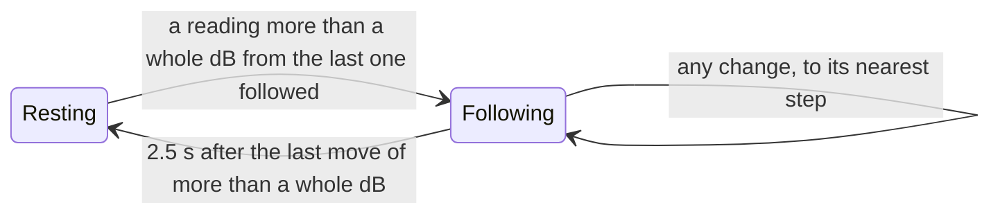

That rule covers nearly everything we've seen. A turn moves the reading more than a whole dB a poll, again and again, so GLM follows it step by step. Jitter at rest never strays that far, so GLM ignores it. And a slow drift, like the 7 dB in `sleep-wake-darkwake`, moves the level in short spells, each time the reading has crept more than a whole dB. [adapter-status.md](adapter-status.md#what-glm-does-with-the-knob) walks through the captures.

GLM's bursts mark the changes it followed, and they fit the rule in the seven captures we checked, but for three changes. One sits at the edge of the 2.5 s. One came after a reconnect, and GLM followed it 0.7 s late. One came from a knob just plugged in.[^knob-fit] GLM's level has a quirk, too. Now and then, a burst carries the level of the change before, and GLM catches up at its next change.[^knob-lag]

qlm follows the same rule, with a few differences:

| | GLM | qlm |
| --- | --- | --- |
| How long it follows | About 2.5 s | 2.54 s |
| With no volume set | | The knob sets none. |
| The burst | On every change it follows | Only when its volume changes |
| The level | Now and then, the level of the change before | The reading's nearest step, under the ceiling |
| Source | [adapter-status.md](adapter-status.md#what-glm-does-with-the-knob); #18 | `QLMKnob`; `QLMKnobTests`; `QLMKnobGoldenTests` |

We replayed the knob readings of those seven captures through qlm, on the virtual clock, with the app's polls. At every rest point but five, where GLM's level lagged, qlm's level is GLM's.[^knob-golden]

In `qlm-control-first`, qlm jumped to the knob at its first real turn, then followed it. The highest level it sent was −41.5 dB, under a −35 dB ceiling.[^control-run-knob]

### Dim

There's no dim opcode. Dim is a volume frame 20 dB down: in `mute-dim`, `00 31 07` became `00 04 E7`.[^dim-volume] GLM wraps it in a round and the pair.

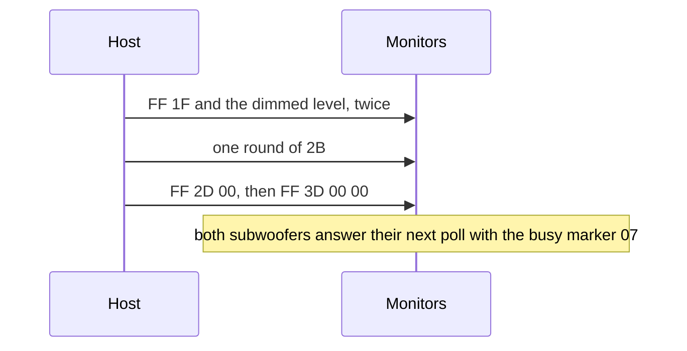

Dim off sends the restored level the same way.[^dim-sequence] `2D 00` is the same for on and off, so it doesn't carry the dim state.[^dim-2d] After the pair, both subwoofers answer their next poll with the busy marker `07`.[^dim-busy]

qlm's dim floors at `00 00 08`. A volume above the ceiling dims from the ceiling.[^qlm-dim] With no volume set, dim sends nothing.[^qlm-dim-nothing] `qlmctl dim` sends GLM's whole dim: it sets the volume first, then dim (#27). Before #27, it sent only the dimmed level.[^qlmctl-dim]

On all six, each `qlmctl dim` sent GLM's sequence, with one frame ahead of it. A new `qlmctl` takes the other dim state first, so it sends the level dim moves from, 1 ms before the rest. Dim off sends the dimmed level for that 1 ms, and no one heard it. After the pair, both subwoofers answered their next poll busy, as after GLM's.[^qlmctl-dim-run]

| Frame | GLM's dim on | qlm's dim on |
| --- | --- | --- |
| The level dim moves from | None | `FF 1F 00 67 9F`, −50 dB |
| The dimmed level, twice | `FF 1F 00 04 E7`, −76.5 dB | `FF 1F 00 0A 5C`, −70 dB |
| One round of `2B 04` | To each monitor | To each monitor |
| The pair | `FF 2D 00`, then `FF 3D 00 00` | The same |
| Source | `mute-dim`, 51.24 s | `qlm-control-all`, 432.033 s |

### Mute and mute all

Muting one monitor means restating all of them. GLM sends two rounds, and the muted monitor gets `03` where the others in the group get `04`. Mute all and unmute all add the level and a frame to the adapter.

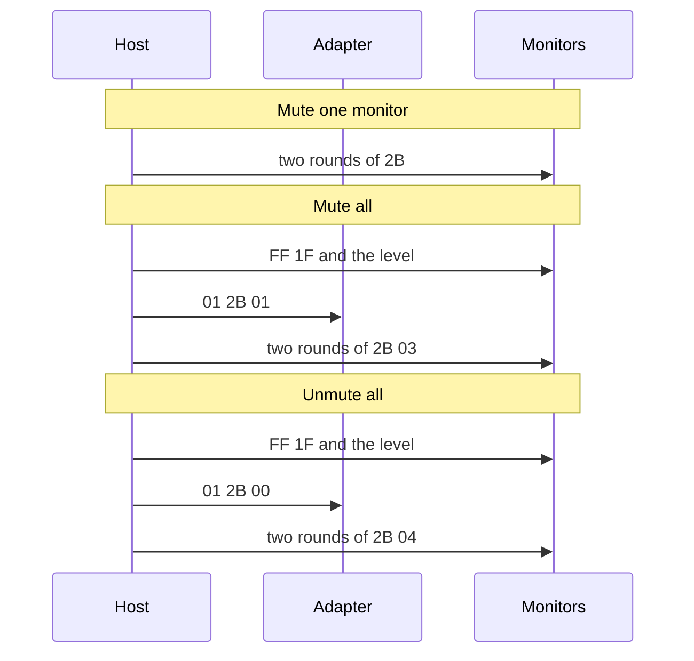

For one monitor, the rounds go to every monitor that is on, in the setup's device order. No volume goes out, and nothing to `01`.[^mute-one]

| Monitor | Gets |
| --- | --- |
| The one being muted | `03` |
| The others in the group | `04` |
| Outside the group | `05` then `07`, or `07` alone in the first of two rounds |

Mute all sends the level once, `01 2B 01`, then two rounds of `2B 03`. Unmute all sends the level, `01 2B 00`, then two rounds of `2B 04`.[^mute-all] Every answered `2B`, to a monitor or the adapter, got a bare `09`: 5,937 in the captures.[^mute-acks]

Because every round restates every monitor that is on, a round from any host unmutes a monitor muted elsewhere. In `qlm-control-first`, the knob's burst unmuted the 7370A, which GLM had muted.[^unmuted-7370a] And since no reply reports mute, qlm keeps the user's mutes itself, by hardware ID, across a lapsed lease (#20). #29 keeps them across a stop too.

If you read `mute-dim`, session `05` is the 7370A and `0B` the 7350A. Its notes call `0B` the big sub, so their sub labels look swapped.[^mute-dim-sessions]

### Sleep and wake

Standby and wake are broadcasts of `3A 03`. The catch is on the way back: every monitor that wakes has lost its lease, so a wake turns into a discovery and an apply.

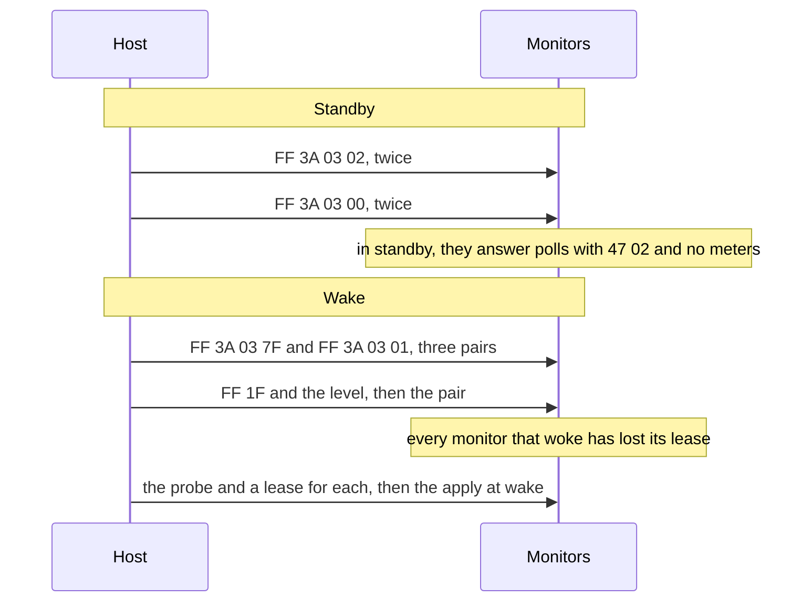

GLM's standby is `FF 3A 03 02` twice, then `FF 3A 03 00` twice.[^standby] hlm says that sending `3A 03 00` twice keeps a monitor from waking by itself when a signal returns.[^standby-twice] In standby, GLM keeps polling and sending the volume, and the monitors answer with `47 02` and no meters.[^in-standby]

The wake is three pairs of `FF 3A 03 7F` and `FF 3A 03 01`, then the level, `FF 2D 00`, and `FF 3D 00 00`.[^wake] Every monitor that wakes loses its lease and answers the next probe. GLM then sends its apply at wake to each, and each gets its state after its first poll.[^wake-apply] [Timing](#timing) has the spacing.

qlm's wake sends the three pairs. Once a volume is set, it ends with the level and the pair, as GLM's does.[^qlm-wake] Since #29, every wake ends with a level: the volume, else the knob's position under the ceiling, else `00 00 08`.

On all six, `wake --volume -50` ran twice, and ended as GLM's does each time. Then all six lost their leases. qlm leased them `09` to `0E`, and sent each the level about 1 ms after its ack. The music came back quietly, at qlm's level.[^qlm-wake-run]

| | GLM's wake | qlm's wake |
| --- | --- | --- |
| Before the pairs | Nothing | The level |
| The pairs | Three, 0.24 and 0.20 s apart | Three, 0.21 s apart |
| After the last pair | The level 0.235 s later, then the pair 23 ms after it | The level 0.247 s later, then the pair at once |
| Then | A lease for each monitor, and the apply at wake | A lease for each monitor, and the level after each ack |
| Source | `standby-wake`, 46.565 to 47.378 s | `qlm-control-all`, 575.096 to 575.935 s |

GLM sends `3A 03` to one monitor only in a group switch. Its own standby is a broadcast.[^unicast-power] A single `3A 03 02` puts a monitor outside the new group in standby.[^single-standby]

### The group apply

An apply sets a group: each monitor's DSP block, its routing, and its power. GLM sends two kinds. The apply at launch and wake sets up monitors it has just leased. A group switch moves the whole system from one group to another. [refused-frames.md](refused-frames.md#the-group-apply) has both, frame by frame, and how System's match GLM's. `QLMApplyGoldenTests` diffs System's against all eight captured applies.

#### At launch and wake

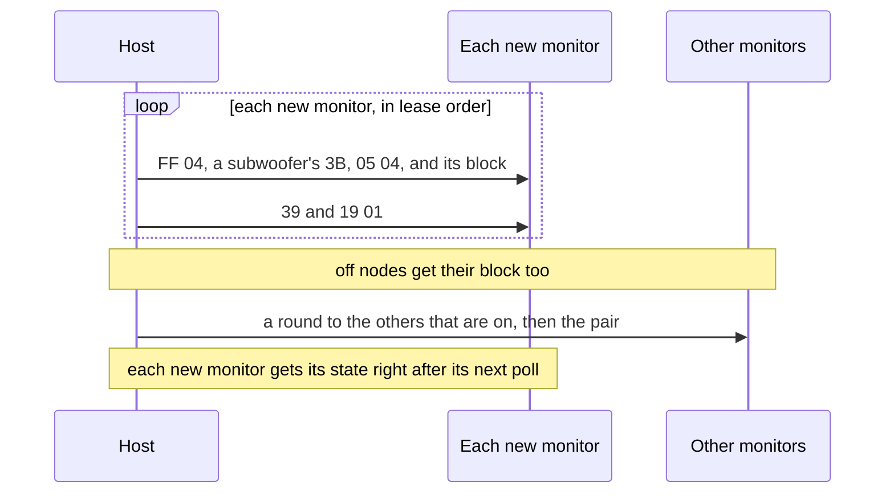

The `05 04` here is the generator stop, `05 04 00 00 00 FF FF EA 00 01 90 00 02 DA`, which qlm refuses.[^apply-launch]

#### A group switch

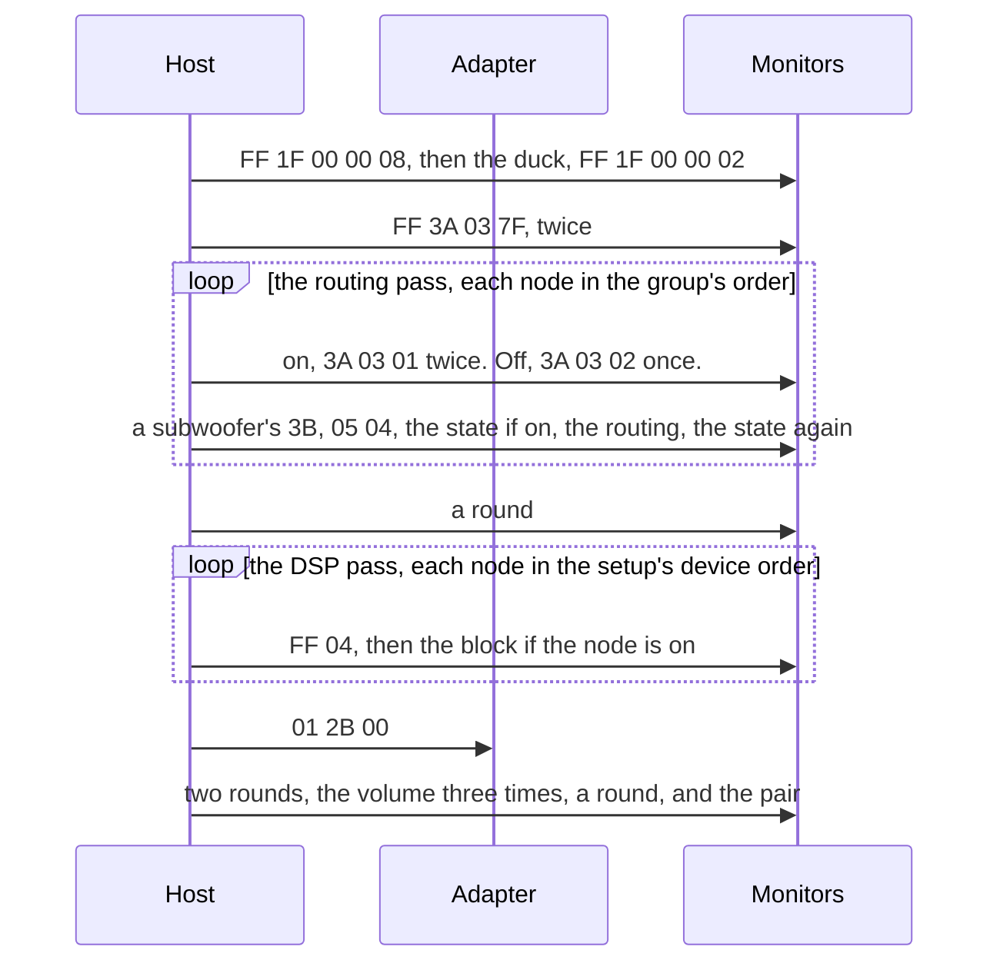

That's the switch from 4x2 to 2x1, where no monitor wakes: `group-switch-main-4x2-main-2x1`, at 12.359 to 13.476 s.[^switch] Two things in the other switches are worth knowing.

A monitor woken into the group loses its lease mid-switch. GLM's frames to its old session get `01 7E`, and GLM applies its block at the new lease beside the switch's tail.[^switch-wake] And GLM's cycle runs beside its apply, so its rounds drop monitors its polls find in standby mid-switch.[^switch-race]

The switches decode to the group switch espgensam documents, with this system's differences: the per-monitor wake, all twenty slots, the 8351B's two extra frames, the subwoofers' repeats, and the tail.[^espgensam]

#### The block

Every block starts with `17 01`. What follows depends on the model.[^block]

| Step | 8330A | 8351B |
| --- | --- | --- |
| 1 | `17 01` | `17 01` |
| 2 | `FF 04` | |
| 3 | `10 02` | `10 02` |
| 4 | `10 01 00` | `10 01 00` |
| 5 | `10 01 09` | `10 01 09` |
| 6 | | `43 00 02` |
| 7 | Twenty `10 0E` | Twenty `10 0E` |
| 8 | `3B` | `3B` |
| 9 | | `4B 00 00 00 01` |
| 10 | `3D 00 00` | `3D 00 00` |
| 11 | `40` | `40` |
| Source | `startup-idle`, 8.538 s | `standby-wake`, 46.581 to 46.807 s |

Only the 8330A gets the extra `FF 04` after `17 01`.[^extra-keep-alive]

The subwoofers, the 7370A and the 7350A, send a longer block, with repeats. Their level pair is `10 01 00` and `10 01 09`. Their routing pair is `40 00 02 00` and the channel, then `40 01 02 00 00`.[^sub-block]

| Step | Frames |
| --- | --- |
| 1 | `17 01` |
| 2 | `10 0E`, slot 0 |
| 3 | `10 02` |
| 4 | The level pair |
| 5 | The routing pair |
| 6 | `3E 00 00`, then `42 00 00` |
| 7 | The routing pair |
| 8 | `3B` |
| 9 | `3C 00 00`, `10 0E` slot 0, and `10 02` |
| 10 | `3C 00 00`, `10 0E` slot 0, and `10 02`, again |
| 11 | The routing pair |
| 12 | `3E 00 00` |
| 13 | The twenty slots, `10 0E` |
| 14 | `3D 00 00` |
| 15 | The routing pair |

#### What qlm leaves out

qlm leaves out `05 04`, and the 8351B's `43` and `4B`. Any real apply with an 8351B is refused until its rate is verified. #31, which went in with #32, allows one behind a flag, as a supervised test, still without `43` and `4B` ([measurement.md](measurement.md)).

No apply by qlm has run on the monitors or been measured yet. [measurement.md](measurement.md) is the procedure.

[^glm-opens]: `startup-idle`, 7.29 to 9.90 s; `unplug`, 68.34 to 69.04 s. [refused-frames.md](refused-frames.md#glms-startup-against-qlms) has each time.
[^glm-level]: [adapter-status.md](adapter-status.md#what-glm-does-with-the-knob).
[^main-sam]: `qlm-control-first`'s notes, after the capture.
[^open-sync]: #33; `testAnOpenSyncsBeforeTheFirstRequest`.
[^qlm-leaves-out]: `qlm-first-discover`; [refused-frames.md](refused-frames.md#the-hand-back).
[^standby-discovery]: `qlm-standby-discover`, 250.3 s.
[^volume-cycle]: `startup-idle`, from 10 s; hlm §7.
[^knob-burst]: `standby-wake`, 0.99 s; `testAKnobTurnIsGLMs`; `knob-sweep`, 19.24 s.
[^knob-round]: [adapter-status.md](adapter-status.md#the-mapping); `testTheKnobNamesTheSteps`.
[^burst-every-change]: #18; `sleep-wake-darkwake`, where the changes GLM doesn't follow bring no burst.
[^knob-rule]: The whole dB: `sleep-wake-no-sleep` and `sleep-wake-darkwake`. The 2.5 s: `sleep-wake-darkwake`, 132.02 and 28.88 s. The rest point: `startup-idle`, 38.48 and 38.59 s.
[^knob-fit]: The captures are `sleep-wake-darkwake`, `sleep-wake-no-sleep`, `knob-sweep`, `startup-idle`, `startup-idle-mic`, `standby-wake`, and `unplug-proxy-hang`. The three changes: `knob-sweep`, 30.81 s; `unplug-proxy-hang`, 106.24 s; `standby-wake`, 0.98 s.
[^knob-lag]: `sleep-wake-darkwake`, 138.96 s, and four more there.
[^knob-golden]: `QLMKnobGoldenTests`. The five are in `sleep-wake-darkwake`.
[^knob-lock]: `volume-sweep`, 25.44 s; its notes.
[^control-run-knob]: `qlm-control-first`, 373.12 s; `testEveryLevelIsGLMsAndUnderTheCeiling`.
[^dim-volume]: hlm §9; `mute-dim`, 51.24 s.
[^dim-sequence]: `mute-dim`, 51.24 s on and 54.77 s off; `testDimIsGLMs`.
[^dim-2d]: [refused-frames.md](refused-frames.md#broadcast-2d-00-and-3d-00-00).
[^dim-busy]: `mute-dim`, 51.658 and 51.664 s.
[^qlm-dim]: `QLMCommands.h`; `testDimFloorsAtTheSlider`.
[^qlm-dim-nothing]: `QLMSystem.h`.
[^qlmctl-dim]: `qlm-control-first`, 538.3 s.
[^qlmctl-dim-run]: `qlm-control-all`, 432.033, 451.793, 8400.569, and 8420.349 s, and its notes; `testDimIsWhole`.
[^mute-one]: `mute-dim`, 19.19 s; `knob-sweep`, 19.135 s; `testMutingOneMonitorIsGLMs`.
[^mute-all]: Mute all: `mute-dim`, 46.19 s; `testMutingAllIsGLMs`. Unmute all: `mute-dim`, 48.60 s.
[^mute-acks]: #27.
[^unmuted-7370a]: `qlm-control-first`, 373.12 s; [telemetry.md](telemetry.md#what-the-meters-showed-about-the-control-run).
[^mute-dim-sessions]: The lease of `0B` in `group-switch-main-2x1-main-2x2`, 10.418 s, against the leases and `39` replies in `startup-idle`, 8.432 to 8.533 s.
[^standby]: `standby-wake`, 34.856 s; `testStandbyIsGLMs`.
[^standby-twice]: hlm §9.
[^in-standby]: `standby-wake`, from 35.68 s.
[^wake]: `standby-wake`, 46.565 to 47.266 s; `testWakeIsGLMs`.
[^wake-apply]: `standby-wake`, 47.70 to 49.09 s; `testWakeApply`.
[^qlm-wake]: #27; `testWakeIsGLMs`.
[^qlm-wake-run]: `qlm-control-all`, 575.096 to 575.935 s and 8481.937 to 8482.778 s, and its notes; `testTheWakeEndsAsGLMs`; `testWokenMonitorsGetTheLevelFirst`.
[^new-monitor]: `qlm-control-all`, 214.751 to 214.777 s, and its notes; `testANewMonitorGetsTheLevelFirst`.
[^unicast-power]: The six `group-switch-*` captures.
[^single-standby]: `group-switch-main-4x2-main-2x2`, 14.249 s; `testSwitchFrom4x2To2x2`.
[^apply-launch]: `startup-idle`, 8.534 to 9.901 s; `testStartupApply`, `testWakeApply`.
[^switch]: `testSwitchFrom4x2To2x1`.
[^switch-wake]: `group-switch-main-2x1-main-4x2`, 35.84 to 36.46 s; `testSwitchFrom2x1To4x2`.
[^switch-race]: `testSwitchFrom4x2To2x2`.
[^espgensam]: #9; espgensam's `docs/glm-group-apply.md`.
[^block]: `QLMDSPBlockGoldenTests`, all 73 captured passes.
[^extra-keep-alive]: `startup-idle`, 8.540 s; `group-switch-main-2x2-main-4x2`, 10.947 s; `QLMApplySequence.m`.
[^sub-block]: [refused-frames.md](refused-frames.md#3c-3e-and-42-to-the-subwoofers).

## What the adapter and the monitors do on their own

Not everything on the bus happens because a host asked. The adapter and the monitors keep state, and act on it after the host has gone. Some of it is a safety issue for qlm, so read this before you test on real monitors.

> **Warning:** a monitor that is switched on plays at its own stored level until a host sends one. When GLM relaunched, two 8330A just switched on played very loud for about a second, until GLM's −56.5 dB reached them.[^loud] That's why qlm sends the volume the moment a lease is acked. On all six, a monitor switched on during a hold got the level 1.1 ms after its ack, and played no burst ([Discovery](#discovery)).

### With no host, the adapter applies the knob

About 2.6 s after the host goes quiet, the adapter takes over at the knob's position ([The hand-back](#the-hand-back)). When qlm stopped at the knob's level, no one heard a change. With qlm stopped, turning the knob moved the level.[^no-host-knob]

qlm's ceiling doesn't reach the adapter. A knob above qlm's level makes the take-over louder.[^ceiling-take-over] We heard it go past the ceiling. Between two runs, the knob was turned up to −32.7 dB. After the wake that followed, the adapter took over at −32.7 dB, above the run's −35 dB ceiling.[^over-ceiling] With no knob in, we don't know what level the adapter applies (#30, which went in with #32).

Nothing tells the adapter the host left. GLM's last frame is an ordinary poll.[^quit-last-frame] At that quit, the knob read −19.8 dB and GLM's level was −20 dB, so the capture can't tell the two apart.[^quit-levels] **Guess:** the adapter takes steady polling as a host's presence.[^presence]

The adapter also talks on the bus, where USB can't see it. While a host is connected, it broadcasts `F0 1F 00 00 00` about every 610 ms, a level the monitors ignore. Standalone, it sends its own level on `F0`. USB shows none of this.[^defer] hlm saw the adapter ramp up to its stored startup level at boot, in steps about 610 ms apart. No capture here shows it.[^ramp]

### Monitors keep their level and their mute

Besides the warning above, a woken monitor keeps the level it had until a host sends one.[^woken-level] We guessed it also stays muted until a host sends its state. After qlm's wake in `qlm-control-first`, every output meter read its floor for 10 s, and qlm sent no `2B`.[^woken-mute] The run on all six says otherwise. After its second wake, with music in, every monitor's output meters rose above their floor 3.4 to 4.0 s after the first pair. qlm sent no `2B`, and the user heard the music come back.[^woken-plays]

A monitor that is switched on gets qlm's level, but not the group's settings. In `qlm-control-all`, the Rear Right 8330A played a little louder than the rest until GLM's launch applied the group, and then it matched.[^own-settings] **Guess:** it ran the settings it had stored, without the group's trims.

A mute outlasts the host, and no reply reports it. The Right 8351B stayed muted after qlm's exit, until `mute off`.[^mute-outlasts] [Telemetry](#telemetry) has why no reply shows it.

### Monitors in standby still answer

They answer discovery and polls without a wake, and stay in standby.[^standby-answers] They miss a request at times ([`01 7E`](#01-7e)).

On or in standby, monitors drop a quiet host's leases, within 23 s to 210 s ([When a monitor loses its lease](#when-a-monitor-loses-its-lease)). And their telemetry clocks count with no host polling: `49` counts seconds since the wake, through standby, leases, and unplugs.[^clock-49]

[^loud]: `qlm-control-first`'s notes, after the capture.
[^no-host-knob]: `qlm-control-first`, 393.7 s, and its notes.
[^ceiling-take-over]: #28; #30, which went in with #32.
[^quit-last-frame]: `quit-glm`, 9.2 s.
[^quit-levels]: `quit-glm`, 0.3 and 9.215 s.
[^presence]: [adapter-status.md](adapter-status.md#how-the-adapter-knows-a-host-is-present).
[^defer]: hlm §9.
[^ramp]: hlm §9.
[^woken-level]: `qlm-control-first`, 827.8 s, and its notes.
[^woken-mute]: [telemetry.md](telemetry.md#what-the-meters-showed-about-the-control-run).
[^woken-plays]: `qlm-control-all`, 8481.938 to 8494.1 s, and its notes.
[^own-settings]: `qlm-control-all`, 214.8 s, and GLM's apply at 379.8 to 380.5 s, and its notes.
[^over-ceiling]: `qlm-control-all`, 8425.4 to 8471.0 s, and 8494.1 s, and its notes.
[^mute-outlasts]: `qlm-control-first`, 648.7 to 660.5 s.
[^standby-answers]: `qlm-standby-discover`.
[^clock-49]: [telemetry.md](telemetry.md#49-seconds-since-the-wake).

## Open questions

| # | Question | What we know, and where |
| --- | --- | --- |
| 1 | Does the adapter escape a `7D` or `7E` address? | No capture has an address above `19`. qlm never leases either ([Framing](#framing)). |
| 2 | Does the adapter answer in order with more than one request in flight? | GLM and qlm keep one in flight, so no capture shows it. qlm's sync assumes it (`QLMReportLink.h`). |
| 3 | What is the adapter's host timeout, and what resets it: any report, or only `01 08`? Does one poll a cycle hold it as well as GLM's pairs? | [adapter-status.md](adapter-status.md#open) |
| 4 | What level does the adapter apply with no knob in? | #30, which went in with #32 |
| 5 | Why do monitors drop a quiet host's leases, and why within 9 s across an unplug? | `unplug` |
| 6 | Does `01 22` or `01 51 82` change what the adapter does on the bus, such as its defer broadcast? | [refused-frames.md](refused-frames.md#open) |
| 7 | What does the `2D 00` and `3D 00 00` pair do to the subwoofers, and what does their busy marker after it mean? | [refused-frames.md](refused-frames.md#open) |
| 8 | What do `3C`, `3E`, `42`, `43`, `4B`, `40 01 02 00 00`, and `10 01 09` carry? | A capture of a change to the LFE fields, `GroupDelayCompensation`, or `BassExtensionXO` could map some ([refused-frames.md](refused-frames.md#open)). |
| 9 | What is the analog routing frame, for input 4? | No group in the setup uses it (#8). |
| 10 | What does the adapter do with `01 2B 01`, and does it keep a mute of its own through the hand-back? | [refused-frames.md](refused-frames.md#open) |
| 11 | What does `82` select in `01 51 82`, and what is `219000`? | [refused-frames.md](refused-frames.md#open) |
| 12 | What is the 8351B's design rate? | Its bands match 96 kHz on the wire, and a measurement must confirm it ([measurement.md](measurement.md)). |
| 13 | Why does GLM's level sometimes lag a change it followed? Why does a knob just plugged in bring a burst for a single tenth? | The rule itself is in [Volume and the knob](#volume-and-the-knob). `sleep-wake-darkwake`, 138.96 s; `standby-wake`, 0.98 s; [adapter-status.md](adapter-status.md#open) |
| 14 | Does a woken monitor stay muted until a host sends its state? | [telemetry.md](telemetry.md#open-questions) |
| 15 | What does `c-` mean in the system info, given that `84` reads `02` for the 8351B? | [System info](#system-info) |
| 16 | What does the adapter do when the host's USB suspends? | The proxy does not forward suspend, and no capture caught a true sleep ([captures/README.md](../captures/README.md)). |
| 17 | Which telemetry tags and meters are still open? | [telemetry.md](telemetry.md#open-questions) |
| 18 | What is the bare `04` that ends two telemetry replies, after `8A`? | [Telemetry](#telemetry) |

## Sources

The footnotes name each fact's source. Together, they draw on:

- The 21 captures in `captures/`, each with its `notes.md`. GLM 5 ran the Phase 0 scenarios on 2026-10-29. qlm ran `qlm-first-discover`, `qlm-standby-discover`, `qlm-control-first`, and `qlm-control-all` on 2026-10-30.
- The tests in `Tests/`, which check these facts against the captures, and the headers in `qlm/GLMProtocol/`.
- hlm's spec, revision 13, at robcazzaro/hlm commit `c08ced9`: §1 to §9, and Appendix B. Facts only. No text was copied.
- genlc's `transport.py`, for the report-ID byte. Facts only. No code was ported.
- espgensam's `docs/glm-group-apply.md`, for the group switch. Facts only.
- Pull requests #8 to #35 in cmicali/qlm. #30 and #31 went in as part of #32.
- [adapter-status.md](adapter-status.md), [refused-frames.md](refused-frames.md), [telemetry.md](telemetry.md), and [measurement.md](measurement.md).
